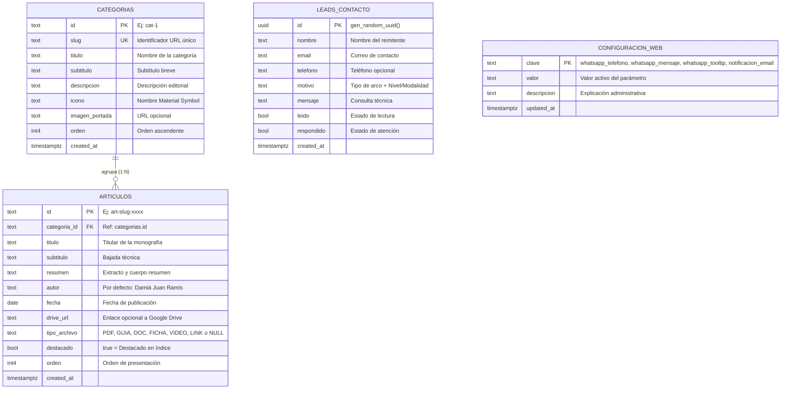

# ERD — Diagrama Entidad-Relación y Modelo de Datos (Supabase Cloud)
## Artículos de Tiro con Arco (`DamiaVercel`)

* **Versión:** 2.0.0
* **Fecha:** 27 de noviembre de 2026
* **Motor único de base de datos:** Supabase (PostgreSQL 17 + PostgREST + Supabase Auth + RLS)
* **Persistencia privada del tirador:** `localStorage` en navegador (`archery_sessions_history`)
* **Ubicación en el repositorio:** `docs/erd.md`

---

## 1. Diagrama Entidad-Relación en Supabase (`public` + `auth`)

---

## 2. Matriz de Seguridad Row-Level Security (RLS)

Todas las tablas del esquema `public` tienen **RLS habilitado** (`supabase/migrations/20261127_secure_rls_and_indexes.sql`):

| Tabla | Rol `anon` (Visitante público) | Rol `authenticated` (Monitor no anónimo) |
| :--- | :--- | :--- |
| `public.categorias` | `SELECT` permitido | `SELECT`, `INSERT`, `UPDATE`, `DELETE` permitidos |
| `public.articulos` | `SELECT` permitido | `SELECT`, `INSERT`, `UPDATE`, `DELETE` permitidos |
| `public.configuracion_web` | `SELECT` permitido | `SELECT`, `INSERT`, `UPDATE`, `DELETE` permitidos |
| `public.leads_contacto` | **Solo `INSERT`** (validando longitud mínima; cero acceso `SELECT`) | `SELECT`, `INSERT`, `UPDATE`, `DELETE` permitidos |

> [!IMPORTANT]
> Al impedir `SELECT` al rol `anon` sobre `public.leads_contacto`, ningún tercero puede leer correos, teléfonos ni mensajes privados aunque conozca la clave pública del proyecto. El backend inserta nuevas consultas con retorno mínimo (`Prefer: return=minimal`).

---

## 3. Índices de Rendimiento Activos en PostgreSQL

* `categorias_pkey` (`UNIQUE btree (id)`)
* `categorias_slug_key` (`UNIQUE btree (slug)`)
* `idx_categorias_orden` (`btree (orden)`)
* `articulos_pkey` (`UNIQUE btree (id)`)
* `idx_articulos_categoria_id` (`btree (categoria_id)`)
* `idx_articulos_orden` (`btree (orden)`)
* `idx_articulos_destacado_orden` (`btree (orden) WHERE destacado = true`)
* `idx_articulos_fecha` (`btree (fecha DESC)`)
* `configuracion_web_pkey` (`UNIQUE btree (clave)`)
* `leads_contacto_pkey` (`UNIQUE btree (id)`)
* `idx_leads_contacto_created_at` (`btree (created_at DESC)`)
* `idx_leads_contacto_respondido` (`btree (respondido)`)

---

## 4. Estrategia de Caché Serverless e Invalidación

1. **Catálogo Público (`getCachedCatalog`):** Cacheado en el Data Cache de Vercel con etiqueta `'catalog'` y revalidación automática cada 120 s, además de purga instantánea (`revalidateTag('catalog')`) tras cualquier alta, edición o borrado en `/admin/articulos` o `/admin/categorias`.
2. **Configuración de WhatsApp (`getCachedSiteConfigMap`):** Cacheada con etiqueta `'site-config'` y purgada al instante (`revalidateTag('site-config')`) al guardar en `/admin/configuracion`.
3. **Cuaderno de Tiro (`localStorage`):** Persistido íntegramente en el dispositivo del arquero bajo la clave `archery_sessions_history` (hasta 50 sesiones completas con tandas e impactos SVG).
